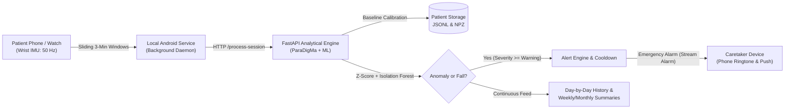
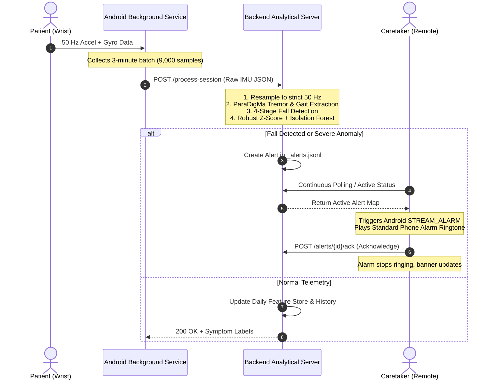
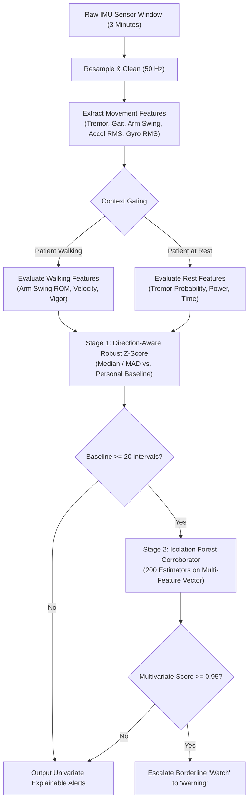
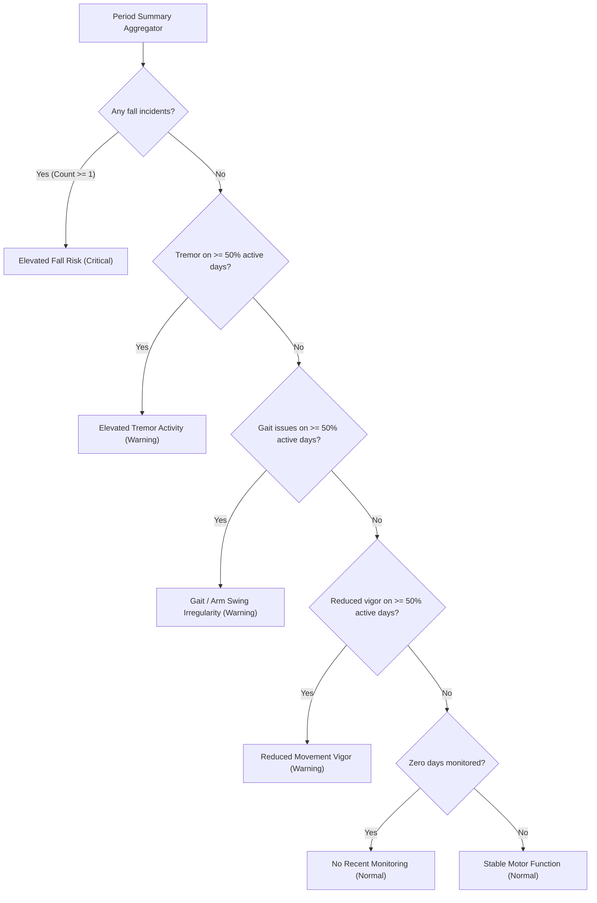

# Parkinson's Disease Continuous Monitoring & Remote Caretaker Alert System
## Comprehensive System Documentation & Technical Blueprint

---

## 1. Executive Summary: What This Project Does

This project is an **end-to-end, medical-grade Parkinson’s Disease (PD) remote monitoring and emergency alert ecosystem**. 

It transforms standard wrist-worn smartwatch and smartphone inertial sensors (accelerometers and gyroscopes) into a continuous diagnostic tool. The system operates autonomously in the background to:
1. **Calibrate a Personal Baseline**: Learns what "normal" motor function looks like for a specific individual (tremor, walking arm swing, and movement vigor).
2. **Detect Abnormal Motor Changes**: Compares every 3-minute window of everyday movement against that personal baseline using robust statistics and Machine Learning (Isolation Forests).
3. **Detect Sudden Falls with High Accuracy**: Analyzes impact physics, rotational tumble, and post-fall immobility using a 4-stage biomechanical algorithm.
4. **Connect Remote Caretakers Over Any Distance**: Pairs a caretaker's phone to the patient's phone using a secure 6-digit one-time code. When a fall or acute motor change occurs, the caretaker's phone sounds a continuous **standard phone alarm ringtone** (even if the app is in the background or the screen is off).
5. **Track Day-to-Day Motor Progression**: Archives daily observations, date-specific alerts, timestamped caregiver clinical notes, key Parkinson’s readings (Tremor Burden %, Movement Vigor Ratio, Active vs. Rest Ratio), and generates automated weekly and monthly clinical narrative reports.



---

## 2. The Clinical Problem: What Patients & Doctors Face Today

### A. The "Snapshot Bias" of In-Clinic Visits
Parkinson’s Disease is inherently **fluctuating**. Symptoms change hour by hour depending on medication timing (the "ON/OFF" medication cycle), stress, fatigue, sleep quality, and diet:
- A patient visits a neurologist once every **3 to 6 months** for a 15-to-30-minute consultation.
- If the appointment coincides with an "ON" phase (medication working well), the doctor sees near-normal motor control.
- If the appointment falls during an "OFF" phase, the symptoms look artificially severe.
- **Consequence**: Medication dosages (e.g., Levodopa/Carbidopa) are frequently calibrated on unrepresentative "snapshots," leading to either under-medication (stiffness, freezing) or over-medication (involuntary writhing/dyskinesia).

### B. Subjective & Inaccurate Patient Diaries
Doctors rely heavily on patients or family members filling out paper logs (e.g., "rate your tremor from 1 to 5 at 2:00 PM"). Studies show that over **60% of entries in self-reported motor diaries are back-filled from memory or inaccurate**, as patients cannot accurately measure arm swing amplitude, subtle resting tremor duration, or movement vigor.

### C. The Danger of Unnoticed Falls & Living Alone
Postural instability is one of the most debilitating symptoms of PD:
- Falls frequently lead to hip fractures, subdural hematomas, and loss of independence.
- When living alone or resting in another room, a patient who falls may remain immobilized on the floor for hours before anyone realizes something is wrong ("long lie" syndrome).

### D. Why One-Size-Fits-All Thresholds Fail
Every Parkinson’s patient is biologically unique. A 70-year-old patient who naturally has a mild resting tremor will constantly trigger false alarms on generic commercial smartwatch detectors. Conversely, a patient with mild rigidity might be overlooked entirely. **A system must be personalized to the individual's baseline.**

---

## 3. How This Solution Solves the Problem

| Traditional Clinical Reality | This System's Solution |
|---|---|
| 15-minute appointment every 3 months | **24/7 continuous passive tracking** at 50 Hz during daily living. |
| Subjective patient memory & paper diaries | **Objective mathematical feature extraction** (spectral tremor power, arm swing range of motion, acceleration RMS). |
| Delayed discovery of accidents | **Immediate loud alarm on Caretaker’s phone** via long-range connection. |
| False alarms from generic population thresholds | **Personal Baseline Calibration**: Anomaly detection tests whether the patient has deviated from *their own calibrated healthy state*. |
| Fragmented clinical notes | **Centralized chronological records**: Date-specific observations, category-tagged clinical notes (`Medication`, `Symptoms`, `Mobility`), and automated clinical narrative summaries. |

---

## 4. End-to-End System Architecture



---

## 5. Detailed Breakdown of Every Feature

### 5.1 Dual Profile Architecture: Patient vs. Caretaker
The application provides two tailored operational modes:
- **Patient Profile**:
  - Focuses on non-intrusive monitoring.
  - Controls to start/stop baseline collection and anomaly monitoring.
  - Access to personal baseline details and the **Load Test Baseline** feature.
  - Generates a **6-Digit One-Time Pairing Code** to securely link a remote caretaker.
  - Displays today's clinical status (Tremor, Gait, Vigor, Fall monitoring).
  - Ability to **shut down any false-positive alert** directly from the patient device.
- **Caretaker Profile**:
  - Displays real-time online/offline connectivity of the patient.
  - Prominent red **Emergency Alarm Banner** with instant "Silence" and "Acknowledge" buttons.
  - Automatically triggers background audio and notifications when emergency events happen.
  - Full access to the patient's day-by-day historical observations, clinical readings, clinical notes, and weekly/monthly summaries.

### 5.2 Long-Range Remote Pairing
Unlike Bluetooth or local Wi-Fi pairing (which stops working once the caretaker leaves the house), this system connects devices over the cloud:
1. Patient generates a 6-digit code (e.g. `481-902`) valid for 15 minutes.
2. Caretaker enters the code along with their name (e.g. `Dr. John` or `Sarah`).
3. The server pairs both profiles permanently until unpaired. The caretaker receives alerts from anywhere with an internet connection.

### 5.3 Personal Baseline System
Before anomaly detection can operate reliably, the app builds a personal baseline:
- Collects reference intervals while the patient is in their standard, stable motor state.
- Tracks feature distributions: Median, Mean, Standard Deviation, Min, Max, and Median Absolute Deviation (MAD).
- Once calibrated (5 or more intervals), the baseline can be **frozen**. Future movement is compared against these frozen values.
- Includes a **Load Test Baseline** feature: Ingests clinical sample reference intervals immediately for demonstration, calibration testing, and review.

### 5.4 The Emergency Alarm & Background Audio System
When an acute fall or critical anomaly is detected:
1. The Caretaker's phone triggers an Android Foreground Service (`CaretakerMonitoringService`).
2. Even if the phone is locked, asleep, or in another app, the system switches audio routing to `AudioAttributes.USAGE_ALARM` on the device's **Alarm Stream (`STREAM_ALARM`)**.
3. It plays the patient's **standard default phone alarm ringtone** at normal alarm volume (not a gentle notification chime), ensuring the caregiver wakes up if the patient falls at night.
4. A high-priority heads-up notification with action buttons allows the caregiver to **Silence Ringtone** or **Acknowledge Alert**.

### 5.5 Day-to-Day Tracking & Historical Calendar
- Every monitored date is saved in durable JSON files (`YYYY-MM-DD_{timestamp}_{session_id}.json`).
- An interactive date navigator bar allows stepping through days (`<`, `>`) or opening a calendar picker to view motor status from any past date.
- Displays processed session counts, total minutes monitored, and date-specific alert history.

### 5.6 Key Clinical Parkinson's Readings
For any selected date, the system computes four quantitative Parkinson's indicators:
1. **Rest Tremor Burden (%)**: The percentage of active monitoring time during which resting tremor probability exceeded baseline limits.
2. **Movement Vigor Ratio**: Ratio of the patient's dynamic acceleration RMS compared to their personal baseline median. A ratio below $0.8\times$ indicates hypokinesia/bradykinesia (slowness and small amplitude of movement).
3. **Active Mobility vs. Rest Ratio (%)**: Percentage of the day spent in active physical motion versus sedentary rest periods.
4. **Fall Triggers**: The exact count of abrupt deceleration impact events recorded on that day.

### 5.7 Persistent Clinical Notes System
Caretakers and patients can record timestamped clinical notes associated with specific dates:
- **Category Tags**: Multi-select tags (`Medication`, `Symptoms`, `Mobility`, `Fatigue`, `Nutrition`, `General`).
- **Author Attribution**: Distinguishes notes logged by the patient from those logged by the caretaker.
- **Thread-Safe Storage**: Persisted in `_notes.json` under atomic locks.

### 5.8 Weekly & Monthly Summaries & Clinical Narratives
- **Window Switcher**: Toggle between **7-Day (Weekly)** and **30-Day (Monthly)** views.
- **Trajectory Classification**: Overall motor trajectory label (`Stable Motor Function`, `Elevated Tremor Activity`, `Gait / Arm Swing Irregularity`, `Reduced Movement Vigor`, or `Elevated Fall Risk`).
- **Automated Clinical Narrative**: A generated, readable paragraph summarizing adherence, total hours monitored, symptom frequency, and fall counts across the period.
- **Day-by-Day Trend Timeline**: A reverse-chronological list of daily breakdown cards. Tapping any day opens the full sensor report for that day.

---

## 6. Technology Stack

### Mobile Frontend (Android / Flutter)
- **Flutter & Dart**: Cross-platform UI framework with custom Material 3 medical-grade design tokens.
- **Flutter Riverpod**: Reactive state management handling patient pairing, alert synchronization, and role profiles.
- **Hive CE**: High-performance local embedded NoSQL database for caching feature vectors and alerts offline.

### Android Native Core (Kotlin)
- **`DayMonitoringService.kt`**: Foreground Service with `PARTIAL_WAKE_LOCK` capturing continuous 50 Hz 3-axis accelerometer and gyroscope streams via Android's `SensorManager`.
- **`CaretakerMonitoringService.kt`**: Continuous background service on the caretaker phone listening for urgent health alerts.
- **`EmergencyNotificationHelper.kt`**: Creates high-priority notification channels, heads-up notifications, and manages `RingtoneManager.TYPE_ALARM` audio playback through `AudioAttributes.USAGE_ALARM`.
- **`EmergencyActionReceiver.kt`**: Handles Android notification action intents (Silence / Acknowledge) without requiring the app to open.

### Backend Analytical Engine (Python)
- **FastAPI**: Asynchronous high-throughput REST API with Pydantic schema validation.
- **Uvicorn**: Lightning-fast ASGI production web server.
- **NumPy & SciPy**: High-performance numerical computing for sensor resampling, DC gravity filtering, RMS calculation, and 3D vector orientation math.
- **Scikit-learn**: Isolation Forest multivariate anomaly model training, scoring, and percentile thresholding.
- **Pandas**: Structured time-series feature aggregation and alignment.
- **ParaDigMa Framework**: Clinical Parkinson’s Disease movement feature extractor.

---

## 7. How Anomaly Detection & the Isolation Forest Work

The anomaly detection engine uses a **two-stage architecture**. A generic Machine Learning model often functions as a "black box" that outputs an unexplained score. In clinical medicine, doctors need to know **which exact symptom changed**.



### Stage 1: Direction-Aware Robust Z-Scores (Univariate)

Standard Z-scores ($Z = \frac{x - \mu}{\sigma}$) are heavily distorted by extreme outliers because the mean ($\mu$) and standard deviation ($\sigma$) are sensitive to extreme values.

Instead, this system uses **Robust Statistics**:
- **Median ($\tilde{x}$)**: Replaces the mean. Represents the patient's typical baseline.
- **Median Absolute Deviation (MAD)**: Replaces standard deviation:
  $$\text{MAD} = \text{median}(|x_i - \tilde{x}|)$$
- The equivalent robust standard deviation is:
  $$\hat{\sigma} = 1.4826 \times \text{MAD}$$

#### Direction Sensitivity
In Parkinson's, different symptoms have opposite "bad" directions:
- **High is Bad** ($\text{direction} = +1$): Rest Tremor Probability, Tremor Power, Tremor Duration. Higher numbers mean more severe tremor.
- **Low is Bad** ($\text{direction} = -1$): Arm Swing Range of Motion, Arm Swing Peak Velocity, Movement Vigor. Lower numbers mean stiffer, slower, more hypokinetic movement.

$$\text{Robust } Z = \text{direction} \times \frac{x - \text{median}}{\max(\hat{\sigma}, \text{NoiseFloor})}$$

#### The Observed Range Gate
Tremor data is zero-inflated (most minutes have 0 tremor, while a few have tremor). This can make the MAD very small. If the patient has an occasional slight tremor, a standard formula might treat it as a huge outlier. 
The system enforces an **observed range gate**: If a value is within the patient’s historical minimum and maximum observed during baseline calibration, it is not flagged as a new anomaly.

---

### Stage 2: Isolation Forest (Multivariate Second Opinion)

When the patient has accumulated 20 or more baseline intervals, an **Isolation Forest** model (`n_estimators=200`, `contamination=0.05`) is trained on the patient's 4-dimensional core vector:
$$\mathbf{v} = [\text{tremor\_probability},\, \text{gait\_probability},\, \text{accel\_rms},\, \text{gyro\_rms}]$$

#### How Isolation Forest Works in Simple Terms
Imagine you have a crowd of people. Most people have normal heights, arm lengths, and walking speeds. If one person has a very unusual combination (e.g., high acceleration but near-zero arm swing and elevated tremor), how many random questions would it take to isolate them from the rest of the crowd?
- **Normal points**: Require many random splits to isolate (deep in the decision trees).
- **Anomalies**: Require very few splits to isolate (short path lengths).

```
Normal Data Point:
  Root -> Split 1 -> Split 2 -> Split 3 -> ... -> Split 12 (Isolated)  [Long Path]

Anomalous Data Point:
  Root -> Split 1 -> Split 2 (Isolated!)                              [Short Path]
```

The Isolation Forest calculates the average path length across 200 random binary trees:
$$s(x, n) = 2^{-\frac{E(h(x))}{c(n)}}$$
Where $E(h(x))$ is the expected tree depth and $c(n)$ is the average depth of an unsuccessful search.

#### The "Corroborator" Rule
In this system, **the Isolation Forest never creates an alert by itself**. Why? Because a black-box anomaly score cannot explain to a doctor *what* is wrong. Instead:
- If Robust Z-score flags a borderline deviation (severity = `watch`), and the Isolation Forest confirms that the multi-dimensional pattern is in the top 95th percentile of abnormality (`if_score >= 0.95`), the system escalates the severity to `warning`.
- This ensures **every single alert remains explainable** with concrete clinical drivers (e.g., *"Arm swing was $2.8\sigma$ below your usual baseline"*).

---

## 8. How Alerts Are Generated: Processing & Comparison Pipeline

### Step 1: Raw Sensor Capture
The smartphone or smartwatch accelerometer ($x, y, z$ in $g$) and gyroscope ($x, y, z$ in $\text{deg/s}$) capture movement at 50 samples per second. Every 3 minutes, 9,000 samples are packaged and uploaded.

### Step 2: Resampling & Normalization
To handle Android hardware clock jitter, the backend resamples the time series onto a uniform 50 Hz grid using linear interpolation. Per-axis DC gravity components are removed using mean subtraction to isolate dynamic movement from tilt.

### Step 3: Biomechanical 4-Stage Fall Detection
Before statistical anomaly scoring, the window is checked by an acute fall detector:
1. **Free-Fall Dip**: Total acceleration magnitude $|a| = \sqrt{a_x^2 + a_y^2 + a_z^2}$ drops below $0.55g$ for at least 2 samples within 0.8 seconds before impact (body falling freely).
2. **Impact Deceleration Peak**: Acceleration spikes to $|a| \ge 3.0g$ while angular velocity $|\omega| \ge 2.0\text{ rad/s}$ ($115^\circ/\text{s}$, indicating a tumble).
3. **Posture Orientation Shift**: The 3D orientation angle of the phone shifts by $\ge 35^\circ$ between pre-impact and post-impact gravity vectors:
   $$\cos\theta = \frac{\mathbf{v}_{\text{pre}} \cdot \mathbf{v}_{\text{post}}}{\|\mathbf{v}_{\text{pre}}\| \|\mathbf{v}_{\text{post}}\|}$$
   *(Prevents false alarms from setting the phone down flat on a desk).*
4. **Post-Impact Immobility**: After the impact ($+0.5\text{s}$ to $+2.5\text{s}$), the motion ceases ($\text{std}(|a|) < 0.35g$ and $\text{mean}(|\omega|) < 1.2\text{ rad/s}$), indicating the person is lying still.

If all 4 conditions match, an immediate **`critical` Fall Alert** is triggered.

### Step 4: Context Gating
Features are split by activity state:
- If arm swing is detected or gait probability $\ge 0.5$, the interval is tagged as `walking`. Arm swing amplitude and walking speed are compared against the walking baseline.
- If not walking, the interval is tagged as `rest`. Tremor probability and power are compared against the resting baseline.

### Step 5: Severity Thresholds & The Alert Engine
A deviation is categorized based on its Robust Z-score:

| Robust Z Score | Severity | Alert Engine Action |
|---|---|---|
| $Z < 2.0$ | **Normal** | Logged as healthy telemetry. No notification. |
| $2.0 \le Z < 2.5$ | **Watch** | Borderline change. Logged in timeline. Escalated to Warning if Isolation Forest score $\ge 0.95$. |
| $2.5 \le Z < 3.5$ | **Warning** | **Generates an alert.** Pushed to Caretaker portal. |
| $Z \ge 3.5$ or **Fall** | **Critical** | **Immediate Emergency Alert.** Caretaker phone sounds loud alarm ringtone. |

#### Spam Suppression & Escalation Rules
- **Cooldown (60 Seconds)**: An ongoing unchanged symptom will not spam the caretaker with repetitive notifications every few seconds.
- **Material Escalation Bypass**: If a symptom suddenly worsens (e.g., Z-score increases by $\ge 20\%$ and at least $+1.0\sigma$), the cooldown is bypassed immediately.
- **Auto-Resolution**: If 3 consecutive intervals return to normal, the alert is automatically closed.

---

## 9. How Patient Status is Classified & Displayed

The user interface translates complex math into intuitive, color-coded medical badges:

### 1. Instant Symptom Classifications (Today's Observations)
- **Tremor**:
  - `Normal`: Within personal baseline ($Z < 2.0$).
  - `Mild / Watch`: Subtle resting tremor ($2.0 \le Z < 2.5$).
  - `Moderate / Warning`: Evident tremor above baseline ($2.5 \le Z < 3.5$).
  - `Severe / Critical`: Intense, sustained resting tremor ($Z \ge 3.5$).
- **Gait & Arm Swing**:
  - `Normal`: Symmetrical, standard arm swing amplitude.
  - `Reduced Arm Swing`: Significant loss of swing amplitude on the monitored wrist.
- **Movement Vigor (Bradykinesia Proxy)**:
  - `Normal`: Dynamic acceleration energy matches baseline.
  - `Reduced Vigor`: Acceleration energy $< 0.8\times$ baseline median (slowness of movement).
- **Fall Monitoring**:
  - `Normal`: Zero impact triggers.
  - `FALL DETECTED`: Active unacknowledged emergency fall.
  - `Fall Acknowledged`: Caretaker or patient has verified and cleared the incident.

### 2. Period Trajectory Classifications (Weekly & Monthly)
When reviewing the 7-day or 30-day summaries, the patient's overarching state is synthesized:



---

## 10. Summary Checklist of System Capabilities

- [x] **Continuous Background Sensing**: 50 Hz IMU monitoring with Foreground Services and battery wake-locks.
- [x] **Personalized Reference Baseline**: Learns individual motor patterns instead of using inaccurate population averages.
- [x] **Two-Stage Anomaly Detection**: Explainable direction-aware Robust Z-Scores combined with multivariate Isolation Forests.
- [x] **High-Precision Fall Detection**: 4-stage biomechanical analysis (free fall, impact peak, orientation shift, immobility).
- [x] **Long-Range Cloud Pairing**: 6-digit one-time codes link Caretakers and Patients across any geographical distance.
- [x] **Loud Emergency Alarms**: Caretaker phone sounds the standard phone alarm ringtone even in background/locked states.
- [x] **Patient Control**: Ability to review baseline calibration, load test data, and dismiss false-positive alerts.
- [x] **Longitudinal Day-by-Day Tracking**: Date navigation, symptoms breakdown, and date-filtered alerts.
- [x] **Key Quantitative Parkinson's Metrics**: Rest Tremor Burden %, Movement Vigor Ratio, Active vs. Rest Ratio, Fall counts.
- [x] **Integrated Clinical Notes**: Category-tagged caregiver observations attached to specific dates.
- [x] **Automated Clinical Narratives**: Dynamic weekly and monthly medical reports for physician consultations.
- [x] **Lightweight Release Build**: Unused libraries and fonts stripped; optimized 64-bit release APK built and running on physical devices.
